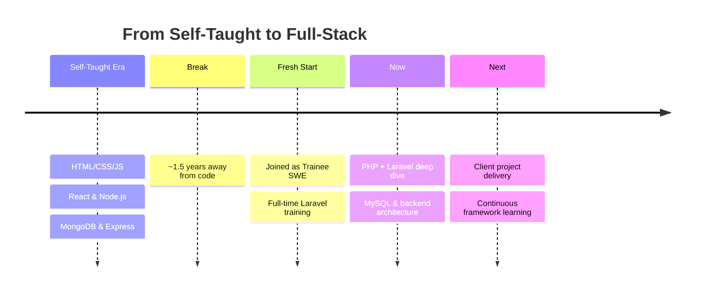

<div align="center">

<a href="https://git.io/typing-svg"></a>

</div>

<p align="center">
  
</p>

<div align="center">
  <a href="https://linkedin.com/in/mahmuda-mahmi"></a>
  <a href="mailto:mahmudapakter@gamil.com"></a>
  <a href="https://mahmuda.codechronic.com"></a>
</div>

<br/>

## 🌱 About Me

```javascript
const mahmuda = {
    role: "Junior Software Engineer",
    currentFocus: "Laravel & PHP Full-Stack Development",
    background: {
        selfTaught: ["JavaScript", "React", "Node.js", "Express.js", "MongoDB"],
        nowMastering: ["PHP", "Laravel", "MySQL"]
    },
    philosophy: "Every framework is just a new language for solving old problems",
    currentlyLearning: true,
    availableForCollab: true
};
```

I'm a software engineer currently deep in an intensive Laravel training program — 3 months, full days, no shortcuts. Before this, I taught myself the JS/React/Node ecosystem and built projects on my own time. Now I'm expanding into PHP and Laravel to become a well-rounded full-stack developer who can adapt to whatever a project needs.

- 🔭 Currently training in **Laravel**, **PHP**, and **MySQL** under a structured mentorship program
- 🌐 Comfortable across the stack: **JavaScript, React, Node.js, Express.js, MongoDB**
- 🎯 Goal: ship production-ready features on a Laravel-based client project
- ⚡ Fun fact: I learn fastest by breaking things first, then figuring out why

<br/>

## 🛠️ Tech Stack

<div align="center">

| Layer | Technologies |
|---|---|
| **Backend (Growing)** |     |
| **Frontend** |     |
| **Databases** |   |
| **Tools** |    |

</div>

<br/>

## 📈 GitHub Stats

<div align="center">
  
  
</div>

<div align="center">
  
</div>


<br/>

## 🗺️ My Learning Path



<br/>

<div align="center">

### 💬 Let's Connect

If you're working with Laravel, PHP, or full-stack JavaScript — or you just want to talk shop about learning to code the hard way — my inbox is open.


</div>
